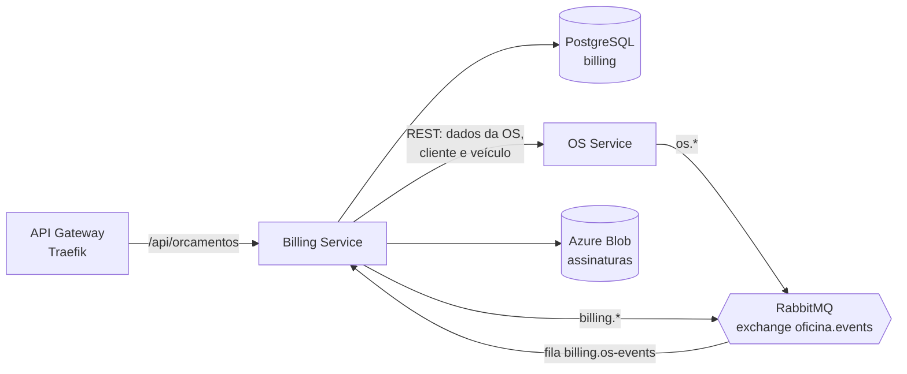

# Oficina — Billing Service

Microsserviço de **orçamento e pagamento** da oficina (Tech Challenge SOAT, Fase 4).
Foi extraído do módulo `orcamento` do monólito
[`fiat-tech-challenge-ddd`](https://github.com/gilgledson/fiat-tech-challenge-ddd).

Responsabilidades:

- Gerar o orçamento de uma OS quando o diagnóstico é concluído.
- Registrar o aceite (com assinatura) ou a rejeição do cliente.
- Registrar o pagamento e avisar os outros serviços.
- Gerar o PDF do orçamento.

## Tecnologias

| Item | Escolha |
|---|---|
| Linguagem / framework | Java 17, Quarkus 3.15 |
| Banco de dados | PostgreSQL próprio (database `billing`), migrações com Flyway |
| Mensageria | RabbitMQ (SmallRye Reactive Messaging) |
| Comunicação síncrona | REST Client para o OS Service |
| Autenticação | JWT RS256 emitido pelo OS Service; aqui só é validado |
| Observabilidade | New Relic (Java Agent), logs JSON com `correlationId` |
| Testes e qualidade | JUnit 5, Mockito, JaCoCo (mínimo de 80%), SonarCloud |

## Arquitetura



O código segue a mesma organização do monólito:

- `domain` — entidade `Orcamento` e regras de negócio.
- `application` — casos de uso, eventos e portas (`gateway`, `repository`).
- `infrastructure` — JPA, outbox, RabbitMQ, cliente REST e armazenamento.
- `api` — endpoints REST.

Nenhum outro serviço acessa o banco do Billing, e o Billing não acessa o banco
de ninguém: a tabela `orcamento` guarda só o identificador da OS, sem chave
estrangeira.

## Saga Pattern: coreografia

O fluxo da OS (abrir → orçamento → aprovação → execução → pagamento) é uma
**Saga coreografada**: não há orquestrador central; cada serviço reage aos
eventos dos outros e publica os seus.

Por que coreografia:

- O monólito já funcionava assim. Os módulos conversavam por eventos em
  memória, então trocar o barramento por um broker preservou o desenho e os
  testes.
- São só três serviços e um fluxo linear; um orquestrador seria mais um
  componente para implantar e manter no ar.
- Cada serviço continua dono das próprias regras, sem um ponto central que
  conheça o fluxo inteiro.

O custo é que o fluxo completo não está escrito em um único lugar. As tabelas
abaixo são essa documentação, e o `correlationId` permite seguir uma OS pelos
logs e traces dos três serviços.

### Eventos consumidos

Fila `billing.os-events`, ligada à exchange `oficina.events` (tipo `topic`).

| Routing key | Payload | O que o Billing faz |
|---|---|---|
| `os.diagnostico-concluido` | `ordemServicoId`, `valorTotal`, `metodoPagamento` (opcional) | Gera o orçamento e publica `billing.orcamento-gerado` |
| `os.execucao-concluida` | `ordemServicoId`, `valorTotal` | Atualiza o orçamento com o valor final |
| `os.cancelada` | `ordemServicoId` | **Compensação:** cancela o orçamento |

### Eventos publicados

| Routing key | Payload | Quando |
|---|---|---|
| `billing.orcamento-gerado` | `orcamentoId`, `ordemServicoId`, `valorTotal` | Orçamento criado, aguardando o cliente |
| `billing.orcamento-aceito` | `orcamentoId`, `ordemServicoId`, `servicosAceitos`, `servicosRejeitados` | Cliente aceitou ao menos um serviço |
| `billing.orcamento-rejeitado` | `orcamentoId`, `ordemServicoId` | **Compensação:** cliente rejeitou tudo |
| `billing.orcamento-falhou` | `ordemServicoId`, `motivo` | **Compensação:** não foi possível gerar o orçamento |
| `billing.orcamento-cancelado` | `orcamentoId`, `ordemServicoId`, `estornoNecessario` | Orçamento cancelado porque a OS foi cancelada |
| `billing.pagamento-confirmado` | `orcamentoId`, `ordemServicoId` | Pagamento registrado |

### Consistência

- **Transactional Outbox:** o evento é gravado na tabela `outbox_evento` na
  mesma transação do orçamento. O `OutboxRelay` entrega os pendentes ao
  RabbitMQ a cada 2 segundos e só marca como publicado depois da confirmação
  do broker.
- **Consumo idempotente:** a entrega é "pelo menos uma vez". Um evento repetido
  não duplica orçamento (há restrição de unicidade por OS) nem repete o
  cancelamento.
- **Fila de mensagens mortas:** mensagem que falha no processamento vai para
  `billing.os-events.dlq`.

## API

Todas as rotas exigem JWT com perfil `ADMIN` ou `ATENDENTE`.

| Método | Rota | Descrição |
|---|---|---|
| `POST` | `/api/orcamentos/{id}/aceitar` | Aceite do orçamento com assinatura em Base64 |
| `POST` | `/api/orcamentos/{id}/confirmar-pagamento` | Registra o pagamento |
| `GET` | `/api/orcamentos/{id}` | PDF do orçamento |
| `GET` | `/api/orcamentos/ordem-servico/{id}` | PDF do orçamento de uma OS |
| `GET` | `/api/orcamentos/ordem-servico/{id}/json` | Orçamento de uma OS em JSON |
| `GET` | `/api/orcamentos/assinaturas/{filename}` | Imagem da assinatura |

Swagger: `/q/swagger-ui`. Healthchecks: `/q/health`.

Para montar o PDF, o Billing chama o OS Service repassando o JWT de quem fez a
requisição:

- `GET /api/integracao/ordens/{id}/orcamento`
- `GET /api/integracao/clientes/{id}`
- `GET /api/integracao/veiculos/{id}`

## Como executar

Requer JDK 17 e Docker.

```bash
./mvnw clean package -DskipTests
```

```bash
docker compose up --build
```

A API sobe em `http://localhost:8384`, o Postgres na porta `25433` e o painel
do RabbitMQ em `http://localhost:15672` (`guest`/`guest`).

Testes e cobertura (falha abaixo de 80% de linhas; relatório em
`target/site/jacoco/index.html`):

```bash
./mvnw clean verify
```

### Variáveis de ambiente

| Variável | Descrição | Padrão |
|---|---|---|
| `DB_URL`, `DB_USERNAME`, `DB_PASSWORD` | Banco do Billing | — |
| `RABBITMQ_HOST`, `RABBITMQ_PORT` | Broker | `localhost`, `5672` |
| `RABBITMQ_USERNAME`, `RABBITMQ_PASSWORD` | Credenciais do broker | `guest` |
| `OS_SERVICE_URL` | URL base do OS Service | `http://localhost:8383` |
| `STORAGE_TYPE` | `local` ou `azure` | `local` |
| `AZURE_STORAGE_CONNECTION_STRING`, `AZURE_STORAGE_CONTAINER` | Blob das assinaturas | emulador Azurite |

## CI/CD

O pipeline em [`.github/workflows/ci.yml`](.github/workflows/ci.yml) tem dois jobs:

1. **Build, testes e qualidade** — em todo PR e push na `main`: compila, roda
   os testes, exige 80% de cobertura e envia a análise ao SonarCloud.
2. **Deploy** — só em push na `main`: publica a imagem no Docker Hub e aplica
   os manifestos de [`k8s/`](k8s) no AKS.

Configuração necessária no repositório:

- Secrets: `SONAR_TOKEN`, `DOCKERHUB_USERNAME`, `DOCKERHUB_TOKEN`,
  `AZURE_CREDENTIALS`, `BILLING_DB_PASSWORD`, `RABBITMQ_USERNAME`,
  `RABBITMQ_PASSWORD`, `AZURE_STORAGE_CONNECTION_STRING`, `NEW_RELIC_LICENSE_KEY`.
- Variables: `SONAR_ORGANIZATION`, `SONAR_PROJECT_KEY`.

## Pendências

- Integração com o **Mercado Pago**: hoje o pagamento é confirmado manualmente
  pelo atendente em `/confirmar-pagamento`.
- Cenário **BDD** do fluxo completo da OS.
- O OS Service ainda precisa expor as rotas `/api/integracao/*` e publicar e
  consumir os eventos das tabelas acima.
- Evidência de cobertura e link do SonarCloud, depois da primeira execução do
  pipeline.
- O serviço ainda não foi executado contra Postgres e RabbitMQ reais; a
  validação até aqui é de compilação e testes unitários.
